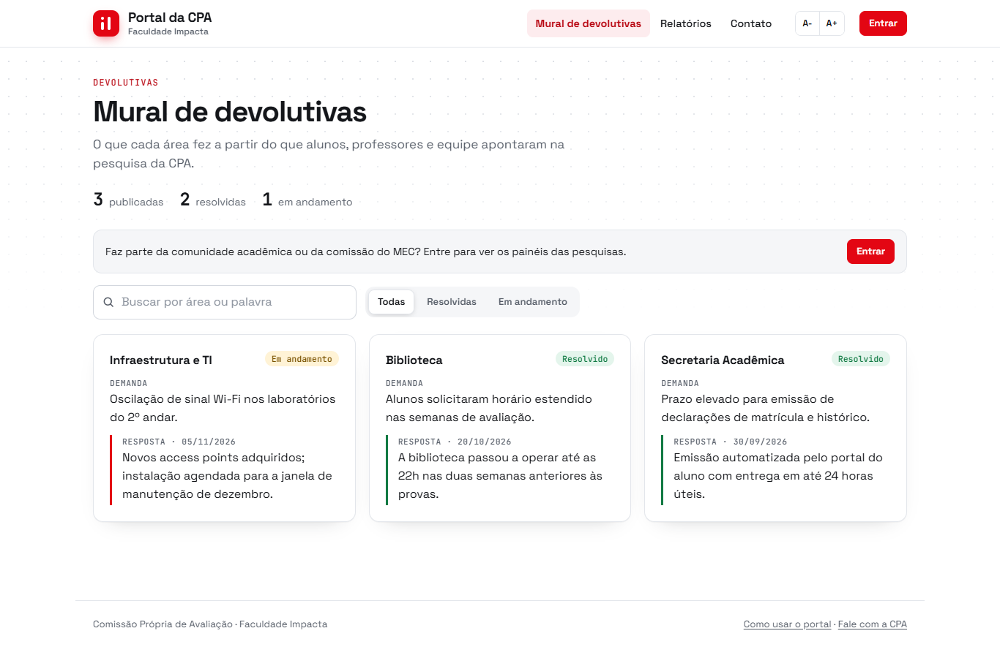
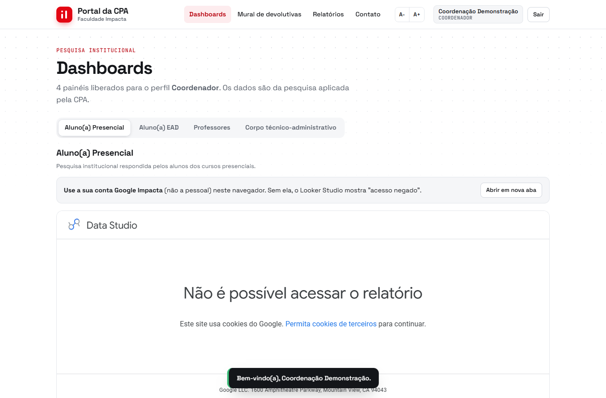
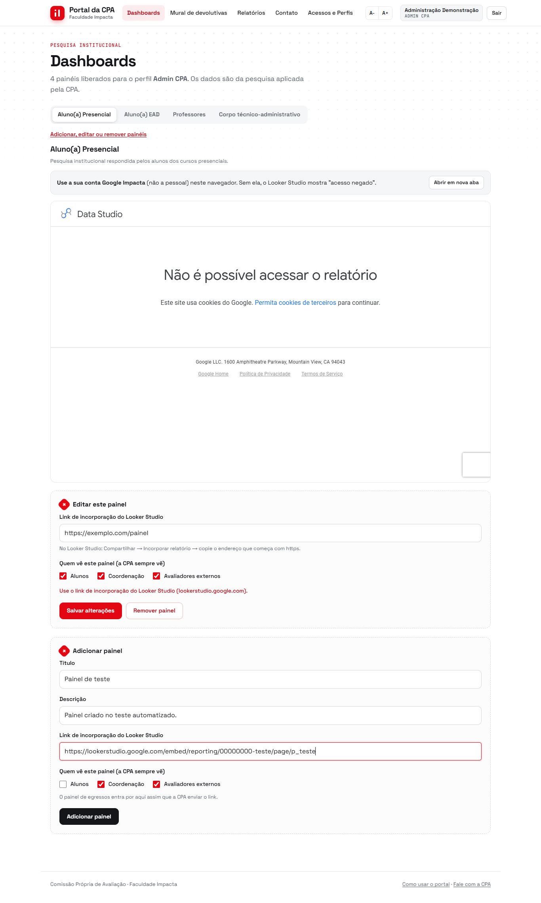
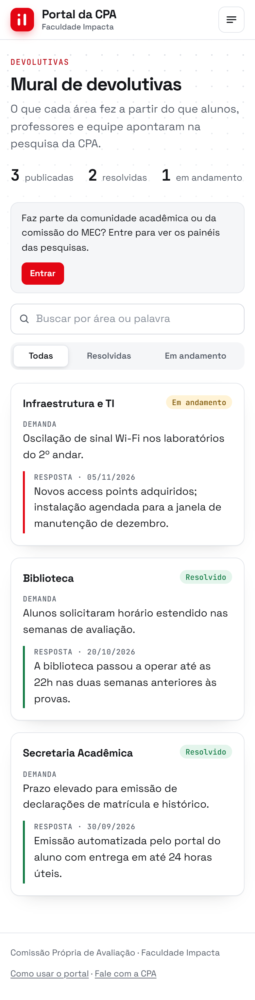

# Portal da CPA — Grupo 2

Projeto de extensão do Centro Universitário Impacta: portal web da **Comissão Própria de Avaliação (CPA)** com níveis de acesso, dashboards das pesquisas, mural de devolutivas e área de relatórios.

## Acesso para avaliação

Portal no ar: **https://cpa.marcosfc.site**

Mural, relatórios e contato abrem sem login. Para ver cada perfil, clique **Entrar** → **Acesso de demonstração (avaliação do projeto)** e use uma das contas abaixo.

Senha das quatro contas: **`CPA-Impacta-2026`**

| Conta | Perfil | O que permite |
|---|---|---|
| `aluno.demo@cpa.marcosfc.site` | Aluno | painéis da pesquisa com alunos (Presencial e EAD), mural, relatórios e contato |
| `coord.demo@cpa.marcosfc.site` | Coordenador | os painéis dos alunos, Professores (avaliação docente) e Corpo técnico-administrativo |
| `avaliador.demo@cpa.marcosfc.site` | Avaliador externo (válido até 31/12/2027) | todos os painéis |
| `admin.demo@cpa.marcosfc.site` | Administração (CPA) | tudo, mais: publicar e remover devolutivas, enviar e remover PDFs, adicionar, editar e remover painéis, editar links de atendimento, autorizar e revogar acessos, histórico e mensagens |

Os dados são **fictícios** e podem ser mexidos à vontade: a equipe restaura tudo com `node scripts/restaurar-demo.mjs` (e remove as contas com `--remover` antes de a CPA cadastrar conteúdo real). A conta de administração de demonstração tem alguns limites para a senha pública não virar problema: não remove o dono do portal nem as outras contas de demonstração (acessos protegidos), não cria outro administrador, não envia e-mails de convite e não vê histórico nem mensagens de pessoas reais.

Os painéis são do Looker Studio e só carregam com uma conta Google da Impacta logada no navegador; sem ela aparece "Não é possível acessar o relatório" (limite do Looker, não do portal).

| Mural (público) | Dashboards da coordenação |
|---|---|
|  |  |

| Administração: painéis | Celular |
|---|---|
|  |  |

### Documentação
- [Requisitos e matriz de permissões](docs/requisitos.md)
- [Modelo de dados](docs/modelo-de-dados.md)
- [Documentação técnica](docs/documentacao-tecnica.md) (arquitetura, login, endpoints, deploy, segurança, limites)
- [Manual do usuário](docs/manual-do-usuario.md)
- [Testes](docs/testes.md) (API, telas, testes de tarefa, casos de erro e roteiro de validação com pessoas)
- [Avaliação de usabilidade (heurísticas de Nielsen)](docs/avaliacao-usabilidade.md)
- [Acessibilidade e desempenho (axe-core, teclado, Lighthouse)](docs/acessibilidade.md)
- [Treinamento: guias rápidos por perfil, roteiro de 30 min e FAQ](docs/treinamento/) (também em PDF, em `docs/treinamento/pdf/`)
- [Evidências (prints por fase e por requisito)](docs/evidencias.md)
- [Plano do projeto](docs/plano.md) · [Dashboards da CPA](docs/dashboards.md) · [Identidade visual](docs/identidade-visual.md) · [KPIs](docs/kpis-cpa.md)

- **Prazo de execução:** 04/09/2026 a 19/11/2026 (120 h)
- **RPE:** Osvaldo Takai · **IPC:** Renato de Souza Santos (Presidente da CPA)
- **Equipe:** Beatriz Naomi Nishimura, Jiulia Paola Rossi Severi, Kaique da Silva Cunha, Marcos Felipe Choppick Pires, Vitória Claudia Furriel da Silva

## O que o portal precisa ter
1. **Login com perfis:** aluno, coordenador, administrador (CPA) e avaliador externo.
2. **Página inicial com dashboards** do Looker Studio (Google Data Studio), conforme o perfil:
   - aluno: pesquisa da CPA;
   - coordenador: pesquisas da CPA, avaliação docente e egressos;
   - avaliador externo: acesso total.
3. **Mural de devolutivas** (público): respostas das áreas às demandas das pesquisas.
4. **Relatórios e boletins:** repositório de documentos (upload e download).
5. **Contato:** links para Google Chat e Google Meet.
6. Tudo **responsivo**.

## Dashboards (dados fictícios, enviados pela CPA)
Os relatórios só abrem com a conta Google da Impacta logada no navegador. Lista em [`docs/dashboards.md`](docs/dashboards.md). Cores e fontes em [`docs/identidade-visual.md`](docs/identidade-visual.md); indicadores em [`docs/kpis-cpa.md`](docs/kpis-cpa.md).

Atenção: o login do portal **não** substitui a permissão do Looker. O avaliador do MEC não tem e-mail Impacta e vai precisar de uma solução própria (compartilhamento individual ou versão pública com dados agregados).

## Plano (6 fases)
Detalhe em [`docs/plano.md`](docs/plano.md).

| Fase | Tema |
|---|---|
| 1 | Levantamento de requisitos |
| 2 | Modelagem e design |
| 3 | Desenvolvimento do portal |
| 4 | Funcionalidades complementares |
| 5 | Testes e validação |
| 6 | Implantação e treinamento |

## Como funciona o login
Todo mundo entra do mesmo jeito: digita o e-mail, recebe um código de 6 dígitos e digita o código no portal.

1. A pessoa informa o e-mail e clica em **Receber código**.
2. O servidor (`api/send-code.js`) confere se o e-mail pode entrar:
   - alunos com `nome@aluno.impacta.edu.br` entram sem cadastro prévio;
   - coordenação, CPA e avaliadores externos precisam estar na tabela `usuarios_cpa` (autorizados pela CPA na tela **Acessos e Perfis**), com a validade em dia.
3. Se puder, o Supabase gera um código de uso único e o portal manda o e-mail pelo Resend. São no máximo 3 envios por e-mail a cada 10 minutos.
4. O navegador confirma o código com o Supabase Auth. A sessão fica guardada pelo próprio Supabase e **Sair** encerra a sessão.
5. O perfil (aluno, coordenador, CPA ou avaliador) é calculado no banco pela função `meu_perfil()`, nunca no navegador. As regras de segurança (RLS) decidem o que cada perfil vê e altera.

Quem vê o quê:

| Recurso | Aluno | Coordenador | Admin CPA | Avaliador MEC |
|---|:-:|:-:|:-:|:-:|
| Painel Aluno(a) Presencial | sim | sim | sim | sim |
| Painel Aluno(a) EAD | sim | sim | sim | sim |
| Painel Professores | – | sim | sim | sim |
| Painel Corpo técnico-administrativo | – | sim | sim | sim |
| Mural de devolutivas e relatórios | sim | sim | sim | sim (também sem login) |
| Administração do portal | – | – | sim | – |

O painel de **egressos** ainda não foi enviado pela CPA. Quando chegar, a administração adiciona em Dashboards → **Adicionar painel** (perfis Coordenação e Avaliadores externos), sem mexer no código. Matriz completa em [docs/requisitos.md](docs/requisitos.md).

As contas de demonstração (`@cpa.marcosfc.site`) entram com e-mail e senha (`signInWithPassword`); o resto do fluxo é o mesmo.

## Estrutura de pastas
```
index.html              página do portal
cpa.html                redireciona o endereço antigo para /
assets/
  config.js             endereço e chave pública do Supabase
  app.js                telas, rotas (#mural, #login...) e chamadas ao banco
  styles.css            visual
api/                    funções da Vercel (rodam no servidor)
  send-code.js          envia o código de acesso
  convite.js            autoriza e convida coordenação, CPA e avaliadores (só CPA)
  contato.js            recebe o formulário de contato
  _lib/                 cliente do Supabase, envio de e-mail e modelos de e-mail
supabase/
  schema.sql            tabelas, funções, regras de segurança e bucket dos PDFs
  migracoes/002_demo.sql contas de demonstração, acessos protegidos, gestão de painéis
  seed.sql              dados iniciais
scripts/
  upload-relatorios.mjs envia os PDFs oficiais da CPA para o Storage
  restaurar-demo.mjs    recria as contas de demonstração e desfaz o que elas mexeram
  testar-api.mjs        testes de permissões, segurança e erros pela API
  testar-telas.mjs      testes no navegador e prints de docs/img
  checar-sintaxe.mjs    confere a sintaxe de todos os arquivos .js
docs/                   requisitos, modelo de dados, documentação técnica, manual, testes e evidências
```

## Variáveis de ambiente
Cadastre na Vercel (Settings → Environment Variables) e, para rodar localmente, num arquivo `.env` (modelo em [`.env.example`](.env.example)).

| Variável | Para quê |
|---|---|
| `SUPABASE_URL` | endereço do projeto Supabase (`https://xxxx.supabase.co`) |
| `SUPABASE_SERVICE_ROLE_KEY` | chave de serviço do Supabase. Fica só no servidor; nunca vai para `assets/` |
| `RESEND_API_KEY` | chave da API do Resend |
| `EMAIL_FROM` | remetente, ex.: `Portal da CPA <cpa@seudominio.com.br>`. Sem ela, usa `onboarding@resend.dev` |
| `CPA_EMAIL` | caixa que recebe as mensagens do formulário de contato |
| `PORTAL_URL` | endereço público do portal, sem barra no final (vai nos links dos e-mails) |

A chave **pública** (`anon`) do Supabase vai em `assets/config.js`, junto com o endereço do projeto. Ela pode ficar no navegador: o que cada pessoa consegue fazer é decidido pelas regras do banco.

## Como preparar o Supabase
1. Crie o projeto no Supabase.
2. Em **SQL Editor**, rode `supabase/schema.sql` e depois `supabase/seed.sql`. Os dois podem ser rodados de novo sem duplicar dados. (Num banco que já tinha a versão anterior do `schema.sql`, rode antes `supabase/migracoes/002_demo.sql`.)
3. Em **Authentication → Sign In / Providers → Email**:
   - deixe o provedor de e-mail ligado e a confirmação de e-mail ligada;
   - **desligue "Allow new users to sign up"** (as contas são criadas só pelo servidor, depois da checagem);
   - ajuste a validade do código (**Email OTP Expiration**) para `600` segundos e o tamanho (**Email OTP Length**) para `6`.
4. Envie os relatórios oficiais (pasta `../relatorios`, ao lado do projeto):
   ```
   SUPABASE_URL=... SUPABASE_SERVICE_ROLE_KEY=... node scripts/upload-relatorios.mjs
   ```
   No PowerShell: `$env:SUPABASE_URL="..."; $env:SUPABASE_SERVICE_ROLE_KEY="..."; node scripts/upload-relatorios.mjs`
5. Preencha `assets/config.js` com o endereço e a chave `anon` do projeto.

O seed já deixa `marcos.pires@aluno.impacta.edu.br` como administrador da CPA (acesso protegido) e cadastra as contas de demonstração. As senhas das contas de demonstração são criadas por `node scripts/restaurar-demo.mjs`. Os demais acessos são liberados pela tela **Acessos e Perfis**.

## Como enviar e-mails (Resend)
1. Crie uma conta no Resend e gere uma API key.
2. Verifique um domínio próprio em **Domains** e use um remetente desse domínio em `EMAIL_FROM`.

Sem domínio verificado, o Resend só entrega para o e-mail dono da conta (o remetente `onboarding@resend.dev` é só para teste). Ou seja: os alunos não recebem o código até o domínio estar verificado.

## Como rodar localmente
Precisa de Node 20 ou mais novo.

```
npm install
cp .env.example .env      # preencha os valores
npx vercel dev
```

O `vercel dev` serve a página e as funções de `/api` em `http://localhost:3000` (na primeira vez ele pede login na Vercel e para ligar a pasta a um projeto). Abrir o `index.html` direto no navegador ou com um servidor simples mostra as telas, mas o login e o contato não funcionam sem as funções.

Para conferir a sintaxe de todos os arquivos: `npm run check`.

Testes automatizados (usam o `.env.local` e o portal publicado; criam só dados de teste e apagam no final):

```
npm run testar:api       # permissões, segurança e casos de erro
npm run testar:telas     # telas no navegador (Edge ou Chrome) e prints de docs/img
npm run testar:tarefas   # tarefas por perfil (cliques, campos e tempo)
npm run testar:acessibilidade  # axe-core em todas as telas + navegação por teclado
npm run restaurar-demo   # volta a demonstração ao estado inicial
```

## Onde fica cada coisa
- **Código:** este repositório.
- **Documentos, planilhas e vídeos:** pasta da equipe no Google Drive (link na aba Execução do portal de extensão).

## Como contribuir
1. Crie uma branch a partir da `main` (`feature/nome-curto`).
2. Faça commits pequenos e com mensagem clara.
3. Abra um Pull Request e peça revisão de um colega antes de juntar na `main`.
