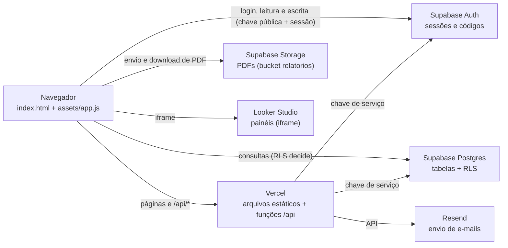
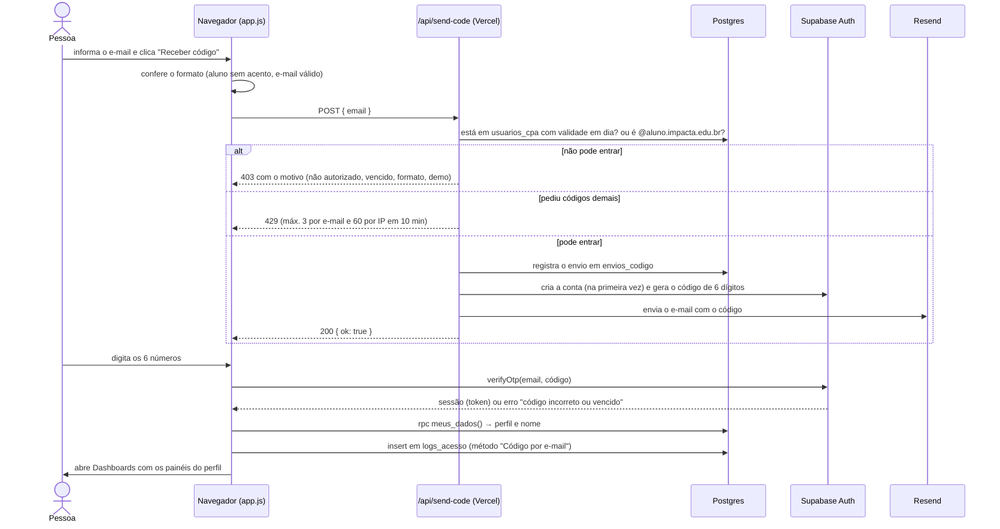

# Documentação técnica

Portal no ar: https://cpa.marcosfc.site · Código: este repositório · Banco: Supabase · Hospedagem: Vercel · E-mails: Resend.

## 1. Arquitetura



- **Front-end estático** (`index.html`, `assets/`): uma página só, com rotas por `#` (`#mural`, `#relatorios`, `#contato`, `#login`, `#dashboards`, `#acessos`). Usa a biblioteca `@supabase/supabase-js` (carregada do jsDelivr, versão fixa) com a chave **pública** do projeto. Sem framework e sem etapa de build.
- **Funções da Vercel** (`api/`): rodam no servidor, com a chave **de serviço** do Supabase. Fazem o que o navegador não pode fazer sozinho: decidir quem recebe código de acesso, enviar e-mails e gravar convites e mensagens.
- **Supabase**: Auth (contas e sessões), Postgres (dados e regras de acesso) e Storage (PDFs).
- **Resend**: envio dos e-mails de código, convite e aviso de mensagem de contato.
- **Looker Studio**: os painéis são da CPA; o portal só incorpora o link em um iframe.

Quem pode ver e alterar o quê é decidido **no banco** (função `meu_perfil()` e regras RLS), não no navegador. O menu esconder um botão é só conforto; a proteção está no banco. Detalhes em [modelo-de-dados.md](modelo-de-dados.md).

## 2. Login

### 2.1 Código por e-mail (alunos, coordenação, CPA, avaliadores)



O código vale 10 minutos e só pode ser usado uma vez (configuração do Supabase Auth). O botão "Reenviar código" fica bloqueado por 60 segundos.

### 2.2 Senha (só contas de demonstração)

Na tela de login, o link **"Acesso de demonstração (avaliação do projeto)"** abre e-mail e senha. O navegador só aceita e-mails `@cpa.marcosfc.site` e chama `sb.auth.signInWithPassword`. Depois disso o caminho é o mesmo do código: `meus_dados()`, registro em `logs_acesso` (método "Senha (demonstração)") e Dashboards. O `/api/send-code` recusa essas contas (elas não têm caixa de e-mail). O cadastro público do Supabase está desligado, então ninguém cria conta com senha por fora.

### 2.3 Sessão e saída

A sessão fica guardada pelo Supabase no `localStorage` do navegador (chave `sb-<projeto>-auth-token`) e é renovada sozinha. **Sair** apaga a sessão. Se a sessão estiver vencida e não puder ser renovada, o portal volta a mostrar a tela de login.

## 3. Endpoints `/api`

Todos aceitam só `POST` com corpo JSON (outro método → `405`) e respondem JSON `{ ok: true, ... }` ou `{ ok: false, erro: "mensagem para a pessoa" }`. Corpo maior que 32 KB → `413`.

### `POST /api/send-code`

| | |
|---|---|
| Entrada | `{ "email": "nome@aluno.impacta.edu.br" }` |
| Saída | `200 { ok: true }` (código enviado por e-mail) |
| Erros | `400` e-mail vazio ou inválido · `403` sem acesso, com `motivo`: `nao_autorizado`, `expirado`, `formato` (aluno com acento/espaço) ou `demo` (conta de demonstração) · `429` muitos pedidos (cabeçalho `Retry-After`) · `500` falha ao gerar ou enviar |

### `POST /api/convite`

| | |
|---|---|
| Cabeçalho | `Authorization: Bearer <token da sessão>` |
| Entrada | `{ "email", "role": "coord" \| "cpa" \| "aval", "nome"?, "expira_em"?: "AAAA-MM-DD", "enviar"?: true }` |
| Saída | `200 { ok: true, enviado: true \| false, aviso? }` |
| Regras | quem chama precisa ser CPA; coordenação precisa de `@impacta.edu.br`; CPA aceita `@impacta.edu.br` ou `@aluno.impacta.edu.br`; avaliador precisa de nome e validade a partir de hoje; ninguém altera o próprio perfil nem um acesso protegido; a conta de demonstração não cria administrador e não envia e-mail (o acesso é salvo e volta um `aviso`). |
| Erros | `400` dados inválidos · `401` sem sessão ou sessão vencida · `403` não é CPA, acesso protegido ou demonstração criando administrador · `500` falha ao gravar |

### `POST /api/contato`

| | |
|---|---|
| Entrada | `{ "nome", "email", "mensagem", "site": "" }` |
| Saída | `200 { ok: true }`: mensagem gravada em `mensagens_contato` e aviso por e-mail para `CPA_EMAIL` (com "responder para" o e-mail da pessoa) |
| Regras | nome até 120 caracteres; mensagem de 5 a 4.000; até 5 mensagens por e-mail por hora; `site` é um campo escondido: se vier preenchido (robô), responde `200` e descarta |
| Erros | `400` dados inválidos · `429` limite por hora · `500` falha ao gravar (se só o e-mail falhar, a mensagem fica salva e a resposta é `200`) |

As demais operações (mural, relatórios, painéis, links, acessos) são feitas pelo navegador direto no Supabase, sempre passando pelas regras RLS.

## 4. Estrutura do código

| Caminho | Conteúdo |
|---|---|
| `index.html` | estrutura da página (topo, menu do celular, área de conteúdo, rodapé) |
| `cpa.html` | redireciona o endereço antigo para `/` |
| `assets/config.js` | endereço e chave pública do Supabase |
| `assets/app.js` | estado, rotas, telas (`vLogin`, `vDash`, `vMural`, `vRel`, `vContato`, `vAcessos`), ações de administração e eventos |
| `assets/styles.css` | visual, responsividade e acessibilidade |
| `api/send-code.js`, `api/convite.js`, `api/contato.js` | funções do servidor (comentário no topo de cada uma explica entrada e saída) |
| `api/_lib/` | cliente do Supabase com a chave de serviço, envio pelo Resend, modelos de e-mail, regras de e-mail e utilidades HTTP |
| `supabase/` | `schema.sql`, `migracoes/`, `seed.sql` |
| `scripts/upload-relatorios.mjs` | envia os PDFs oficiais da CPA |
| `scripts/restaurar-demo.mjs` | recria as contas de demonstração e desfaz o que elas mexeram |
| `scripts/testar-api.mjs` | testes de permissões, segurança e erros pela API |
| `scripts/testar-telas.mjs` | testes no navegador e prints de `docs/img` |
| `scripts/checar-sintaxe.mjs` | `node --check` em todos os arquivos `.js`/`.mjs` |

## 5. Variáveis de ambiente

Cadastradas na Vercel (Settings → Environment Variables). Para rodar localmente, num arquivo `.env.local` (fora do Git; modelo em [`.env.example`](../.env.example)).

| Variável | Usada por | Para quê |
|---|---|---|
| `SUPABASE_URL` | funções `/api`, scripts | endereço do projeto Supabase |
| `SUPABASE_SERVICE_ROLE_KEY` | funções `/api`, scripts | chave de serviço (só no servidor, nunca no navegador nem no Git) |
| `RESEND_API_KEY` | funções `/api` | chave do Resend |
| `EMAIL_FROM` | funções `/api` | remetente com domínio verificado no Resend |
| `CPA_EMAIL` | `/api/contato` | caixa que recebe as mensagens do formulário |
| `PORTAL_URL` | funções `/api` | endereço público usado nos links dos e-mails |
| `POSTGRES_URL_NON_POOLING` | scripts | conexão direta ao Postgres (restaurar a demonstração, testes) |
| `SUPABASE_ANON_KEY` | `scripts/testar-api.mjs` | chave pública (a mesma de `assets/config.js`) |

As demais variáveis que aparecem na Vercel (`POSTGRES_*`, `NEXT_PUBLIC_*`, `SUPABASE_JWT_SECRET`...) foram criadas automaticamente pela integração Supabase–Vercel e não são usadas pelo código.

## 6. Deploy

O projeto na Vercel se chama `portal-cpa-impacta` e o domínio `cpa.marcosfc.site` aponta para ele.

```
npx vercel deploy --prod --yes
```

Não há build: a Vercel publica os arquivos estáticos e transforma cada arquivo de `api/` em uma função. Cabeçalhos de segurança (`X-Frame-Options`, `nosniff`, `Referrer-Policy`, `Permissions-Policy`) ficam em `vercel.json`.

Mudanças no banco: rode o SQL novo no SQL Editor do Supabase (ou `node` com o `pg`, como faz `restaurar-demo.mjs`) **antes** do deploy que depende dele.

## 7. Como rodar localmente

Precisa de Node 20 ou mais novo.

```
npm install
npx vercel link          # liga a pasta ao projeto portal-cpa-impacta
npx vercel env pull .env.local
npx vercel dev           # http://localhost:3000
```

Sem o `vercel dev`, abrir o `index.html` num servidor simples mostra as telas, mas login por código e contato não funcionam (dependem das funções). Conferir a sintaxe: `npm run check`.

## 8. Demonstração para avaliação

Contas (senha `CPA-Impacta-2026`): `aluno.demo`, `coord.demo`, `avaliador.demo` (validade 31/12/2027) e `admin.demo`, todas `@cpa.marcosfc.site`. Os dados do portal são fictícios.

Para limpar o que for mexido durante a avaliação:

```
node scripts/restaurar-demo.mjs
```

O script (lê `.env.local`):
1. cria ou corrige as 4 contas no Supabase Auth com a senha de avaliação;
2. apaga painéis, devolutivas, documentos (e PDFs enviados), links de atendimento e pessoas autorizadas não protegidas que tenham sido **criados ou alterados por último** por uma conta de demonstração, além das mensagens de contato enviadas por contas de demonstração;
3. reaplica `supabase/seed.sql`;
4. reenvia os 3 PDFs oficiais se algum estiver faltando (pasta `../relatorios` ou `RELATORIOS_PASTA`).

Não mexe no histórico de acessos. Atenção: a regra é "última alteração feita por conta de demonstração". Uma linha criada por uma pessoa real e depois editada pela demonstração (um painel real, uma devolutiva real, os links de atendimento) também é apagada: se estiver no `seed.sql`, volta com os valores do seed; se não estiver, some. O que a demonstração apagou de uma pessoa real não volta. Por isso as contas de demonstração devem existir só enquanto o portal tiver dados fictícios: depois da avaliação, e antes de a CPA cadastrar conteúdo real, rode `node scripts/restaurar-demo.mjs --remover` para apagar as contas.

Além disso, acessos liberados pela conta de demonstração (criados ou alterados por ela) não recebem código por e-mail: `/api/send-code` responde 403. Assim a senha pública não serve para mandar e-mails a terceiros.

## 9. Segurança: o que protege o quê

| Risco | Proteção |
|---|---|
| Alguém "virar" CPA pelo navegador | perfil calculado no banco por `meu_perfil()`; RLS em todas as tabelas; escrita só com `eh_cpa()` |
| Visitante ler dados internos | `usuarios_cpa`, `logs_acesso`, `mensagens_contato` e `envios_codigo` não têm leitura pública; painéis só para perfis |
| Criar conta sozinho | cadastro público desligado no Supabase (`signup_disabled`); contas criadas só pelo servidor depois da checagem |
| Chave secreta vazar | só a chave pública vai ao navegador; chave de serviço e do Resend ficam na Vercel |
| Robôs e abuso | limites de códigos por e-mail e por IP, limite de mensagens, campo-armadilha no contato |
| Remover o dono do portal ou as demonstrações | coluna `protegido` + RLS de alteração/remoção + checagem em `/api/convite` |
| Senha pública da demonstração | a administração de demonstração não cria administrador, não envia e-mails de convite e não vê histórico nem mensagens de pessoas reais; tudo o que ela faz pode ser desfeito por `restaurar-demo.mjs` |
| Link malicioso em painel | o banco só aceita URLs `https://lookerstudio.google.com/` ou `https://datastudio.google.com/`; o iframe tem `sandbox` |
| Arquivo indevido em Relatórios | bucket aceita só `application/pdf` até 50 MB; só a CPA envia |
| Clickjacking | `X-Frame-Options: DENY` |
| XSS | todo texto vindo do banco passa por `esc()` antes de ir para a tela; links só `https` (`seguro()`) |

## 10. Limites conhecidos

- **Looker Studio pede a conta Google da Impacta.** O login do portal não substitui a permissão do Looker. Sem a conta Google da Impacta no navegador (ou com cookies de terceiros bloqueados), o iframe mostra "Não é possível acessar o relatório". Avaliadores externos precisam que a CPA compartilhe o relatório com o e-mail deles ou publique uma versão com dados agregados. O botão "Abrir em nova aba" ajuda quando o navegador bloqueia cookies no iframe.
- **Painel de egressos**: a CPA ainda não enviou o link. Quando enviar, a administração adiciona em Dashboards → "Adicionar painel" (perfis Coordenação e Avaliadores externos).
- **Links de Chat e Meet**: hoje apontam para as páginas iniciais do Google Chat e do Meet; os links reais da sala da CPA precisam ser cadastrados em Contato → "Editar atendimento".
- **Domínio de e-mail**: os e-mails saem pelo domínio verificado no Resend (`EMAIL_FROM`). Ao mudar para um domínio da Impacta, é preciso verificar o novo domínio no Resend.
- **Senha da demonstração é pública** (está no README). Os dados são fictícios e a demonstração tem limites (seção 9); ainda assim, recomenda-se remover as contas depois da avaliação.
- Limite do plano gratuito do Supabase: 50 MB por arquivo e 1 GB de Storage.
