# Manual do usuário — Portal da CPA

Endereço: **https://cpa.marcosfc.site** (funciona no computador e no celular).

O portal reúne os resultados da avaliação institucional da Faculdade Impacta: painéis das pesquisas, mural de devolutivas, relatórios e contato com a CPA. Os prints abaixo são do portal publicado, feitos com as contas de demonstração (dados fictícios).

Sumário: [1. Sem login](#1-o-que-qualquer-pessoa-vê-sem-login) · [2. Entrar](#2-como-entrar) · [3. Aluno](#3-aluno) · [4. Coordenação](#4-coordenação) · [5. Avaliador externo](#5-avaliador-externo) · [6. Administração (CPA)](#6-administração-cpa) · [7. Problemas comuns](#7-problemas-comuns)

## 1. O que qualquer pessoa vê sem login

### Mural de devolutivas
Menu **Mural de devolutivas**. Cada cartão mostra a área, a demanda apontada na pesquisa, a resposta e a situação (Resolvido ou Em andamento).

- Use **Buscar por área ou palavra** para achar um assunto.
- Use **Todas / Resolvidas / Em andamento** para filtrar.

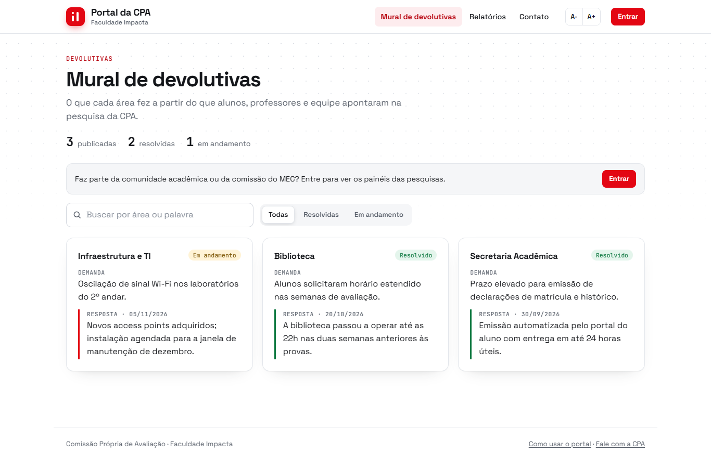

### Relatórios
Menu **Relatórios**. Use **Buscar por título ou ano** para achar um documento (ex.: 2019). **Baixar PDF** salva o arquivo; **Abrir** mostra o PDF numa nova aba. Os relatórios de 2013 a 2023 e o Relato Institucional 2023 abrem direto no site oficial da Impacta (**Abrir PDF**).

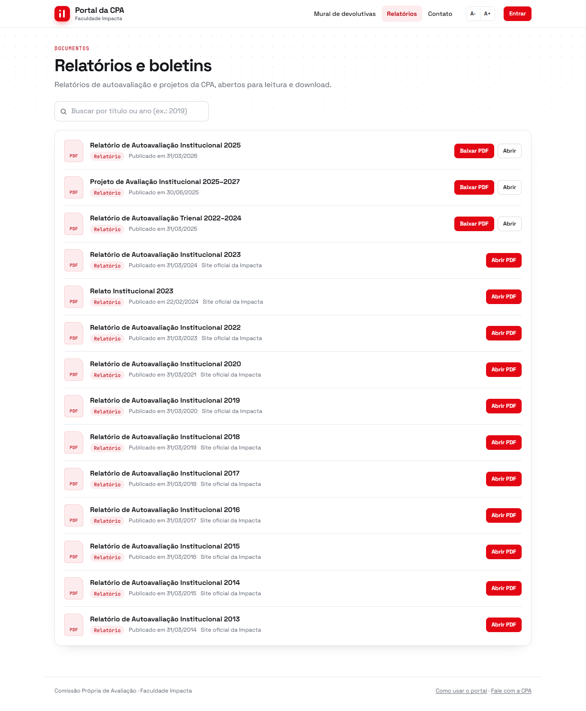

### Contato
Menu **Contato**. À esquerda ficam o horário, os botões do Google Chat e do Google Meet (abrem com a sua conta Google Impacta) e o **e-mail da CPA** (cpa@impacta.edu.br). À direita, o formulário: preencha nome, e-mail e mensagem e clique **Enviar mensagem**. A resposta chega no e-mail informado.

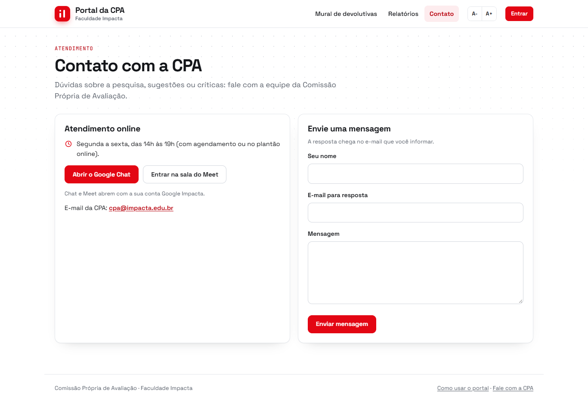

### Ajuda
O link **Como usar o portal**, no rodapé, abre este manual. Guias curtos por perfil e um FAQ estão em [treinamento/](treinamento/).

### Tamanho da letra e celular
Os botões **A-** e **A+** no topo diminuem e aumentam a letra (o portal lembra a escolha). No celular, o menu fica no botão de três linhas, no canto de cima.

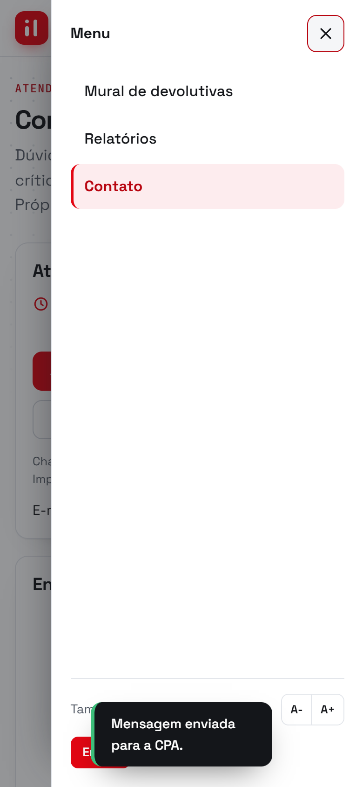

## 2. Como entrar

1. Clique **Entrar** (topo da página).
2. Digite o seu e-mail e clique **Receber código**.
   - Alunos: use o e-mail `@aluno.impacta.edu.br`. Não precisa de cadastro.
   - Coordenação, CPA e avaliadores externos: o e-mail precisa ter sido autorizado pela CPA.
3. Abra o e-mail "… é o seu código de acesso ao Portal da CPA" (confira o spam se não chegar em 1 minuto).
4. Digite os 6 números nas caixinhas (pode colar o código inteiro). O portal entra sozinho quando o sexto número é digitado.
5. Se o código não chegar, espere a contagem de 60 segundos e clique **Reenviar código**.

| Tela de login | Tela do código |
|---|---|
| 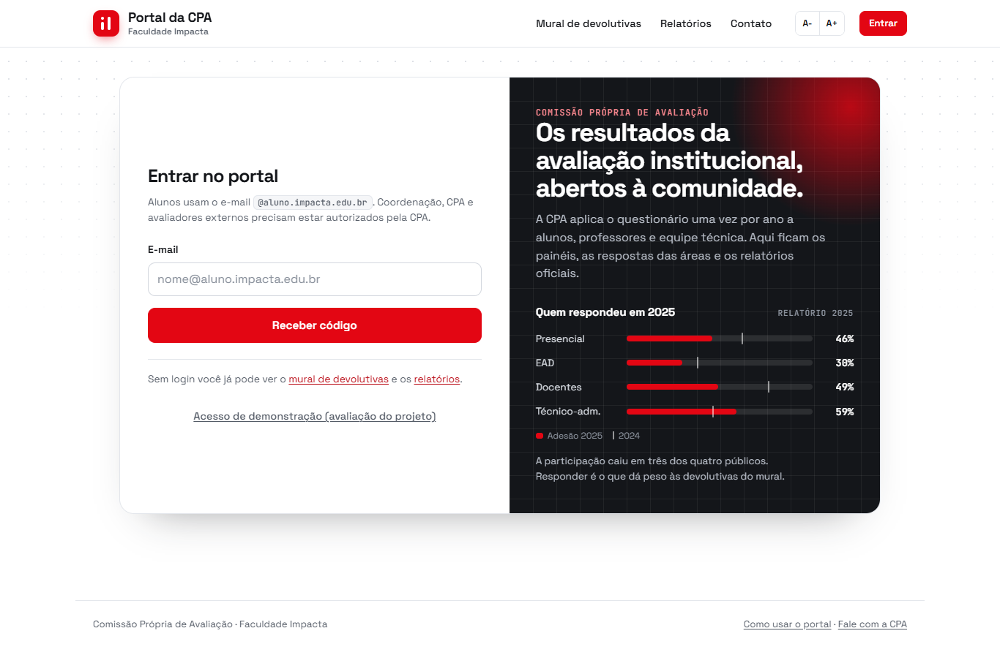 | 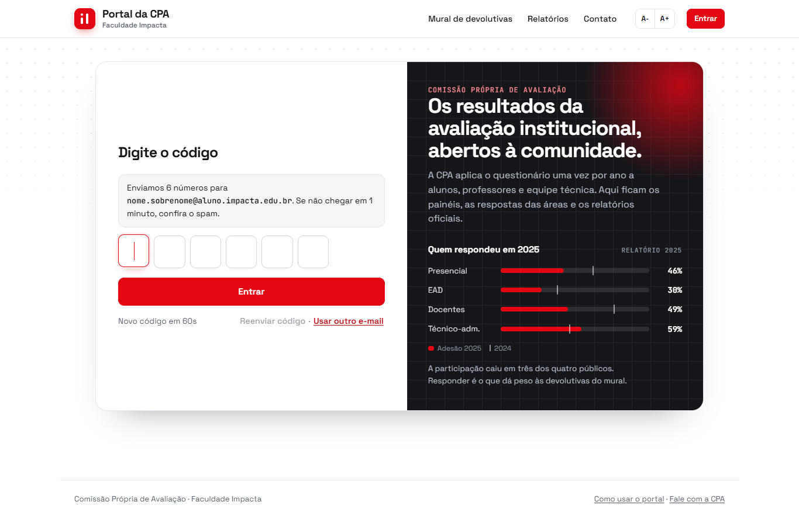 |

O e-mail com o código:

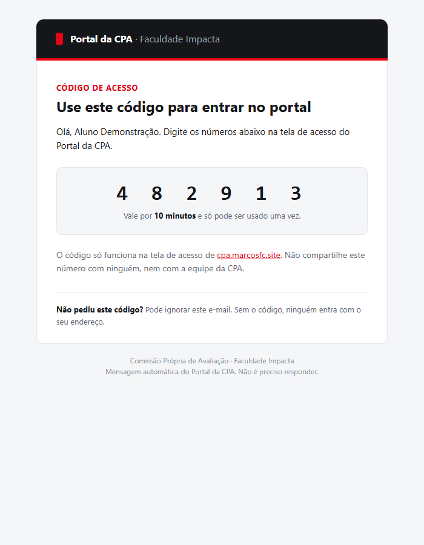

Para sair, clique **Sair** (no celular, dentro do menu).

### Acesso de demonstração (avaliação do projeto)
Na tela de login, clique **Acesso de demonstração (avaliação do projeto)**, digite o e-mail de uma conta de demonstração e a senha (estão no README do repositório) e clique **Entrar**. É usado só para avaliar o projeto; alunos e equipe entram pelo código.

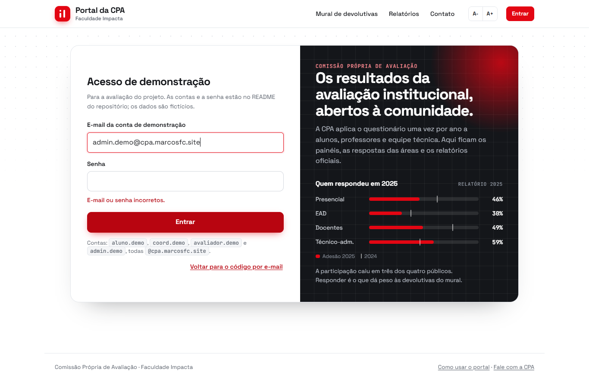

## 3. Aluno

Depois de entrar, você cai em **Dashboards**, com os painéis liberados para alunos: **Aluno(a) Presencial** e **Aluno(a) EAD**. Troque de painel pelas abas.

Os painéis são do Looker Studio (Google). Para eles carregarem, **a sua conta Google da Impacta precisa estar logada neste navegador**. Se aparecer "acesso negado" ou "Não é possível acessar o relatório", entre na conta Google da Impacta ou clique **Abrir em nova aba**.

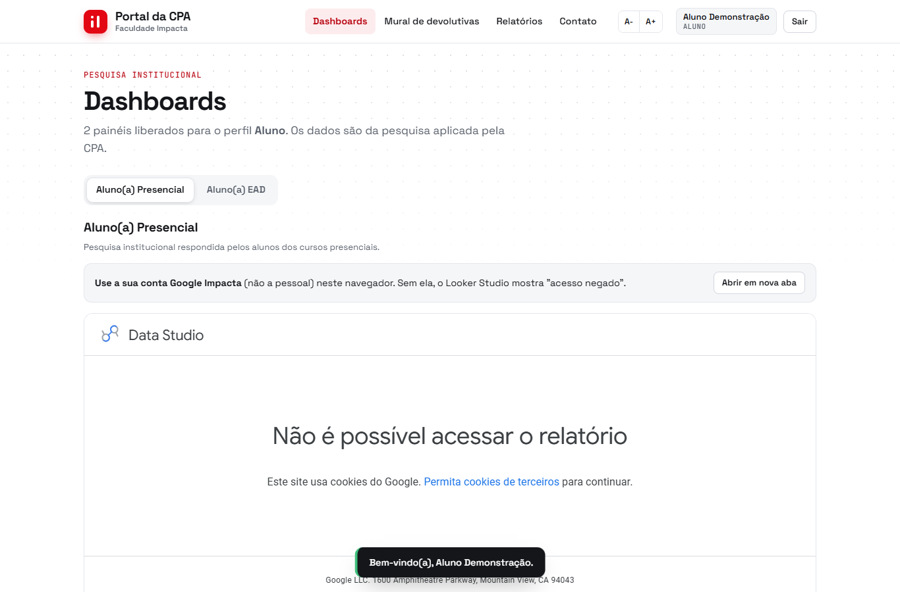

Mural, relatórios e contato funcionam como na seção 1.

## 4. Coordenação

A coordenação vê, além dos painéis dos alunos, os painéis **Professores** (avaliação docente) e **Corpo técnico-administrativo**. O painel de **Egressos** aparece aqui assim que a CPA cadastrá-lo.

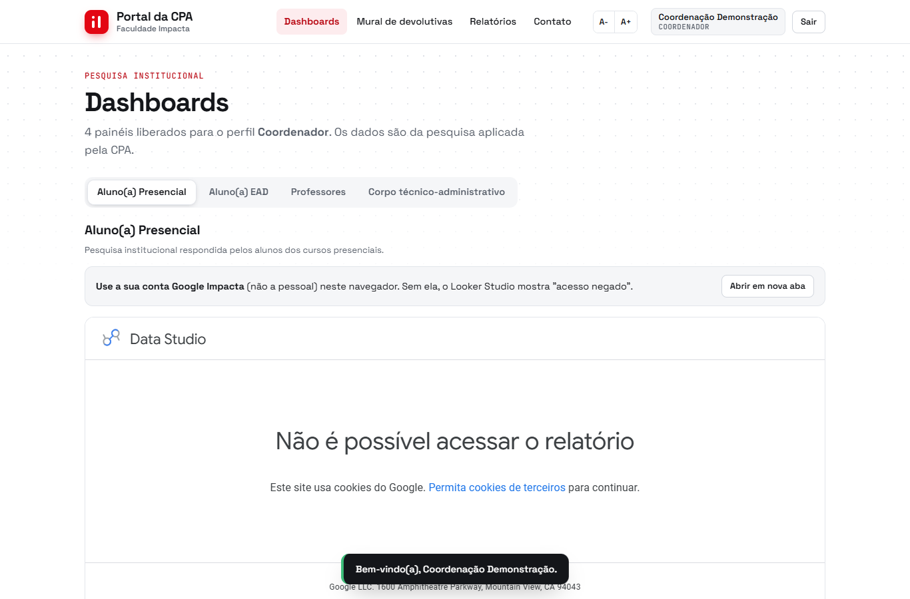

Para ser liberado, peça à CPA que autorize o seu e-mail `@impacta.edu.br`. Você pode receber um convite por e-mail.

## 5. Avaliador externo

O avaliador externo (comissão do MEC/INEP) recebe da CPA um convite por e-mail com o link do portal e a data até quando o acesso vale. Ele entra do mesmo jeito (e-mail + código) e vê todos os painéis.

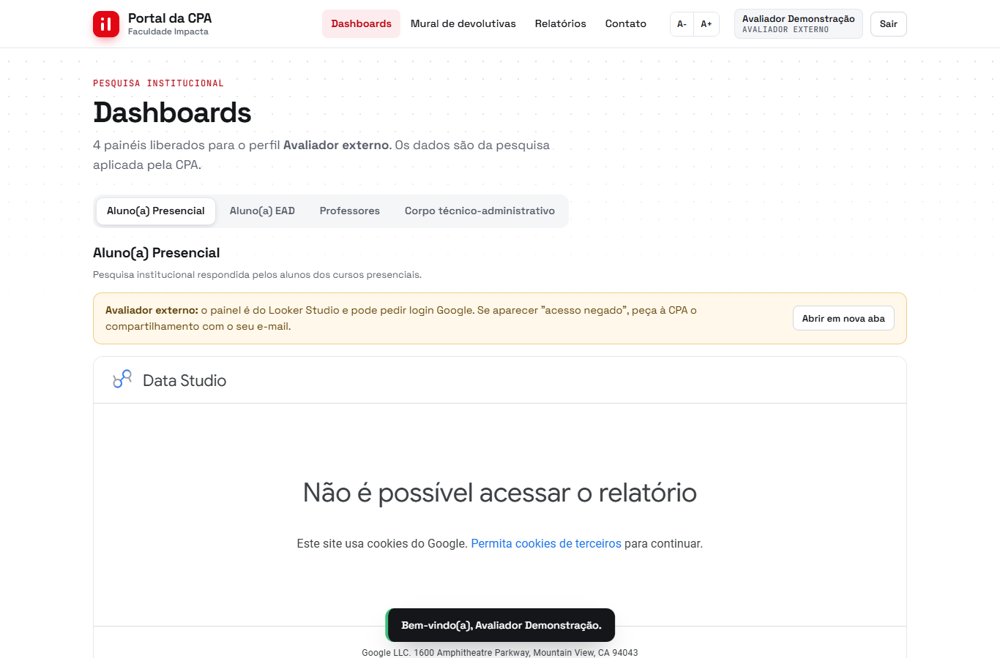

Como os painéis são do Looker Studio, o avaliador precisa que a CPA compartilhe os relatórios com o e-mail dele. O aviso na tela lembra isso. Depois da data de validade, o portal avisa que o acesso terminou e pede a renovação à CPA.

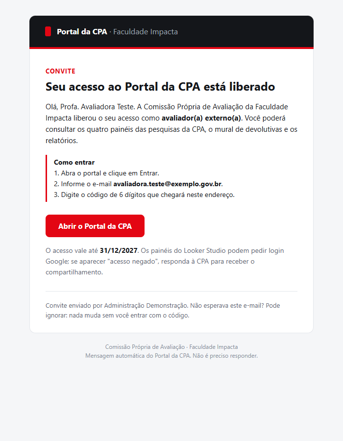

## 6. Administração (CPA)

A CPA vê tudo o que os outros perfis veem e, em cada tela, tem quadros tracejados de administração (clique no título para abrir).

### 6.1 Painéis (Dashboards)
- **Editar este painel**: troque o link de incorporação e marque quem vê o painel (Alunos, Coordenação, Avaliadores externos; a CPA sempre vê). Clique **Salvar alterações**.
- **Remover painel**: pede confirmação antes de apagar.
- O atalho **Adicionar, editar ou remover painéis**, logo acima do painel, leva direto a essas ferramentas.
- **Adicionar painel**: informe título, descrição, link e quem vê. O link precisa ser o de incorporação do Looker Studio (no Looker: Compartilhar → Incorporar relatório → copie o endereço que começa com `https://lookerstudio.google.com/embed/...`).

O painel de **egressos** entra por aqui assim que a CPA tiver o link (marque Coordenação e Avaliadores externos).

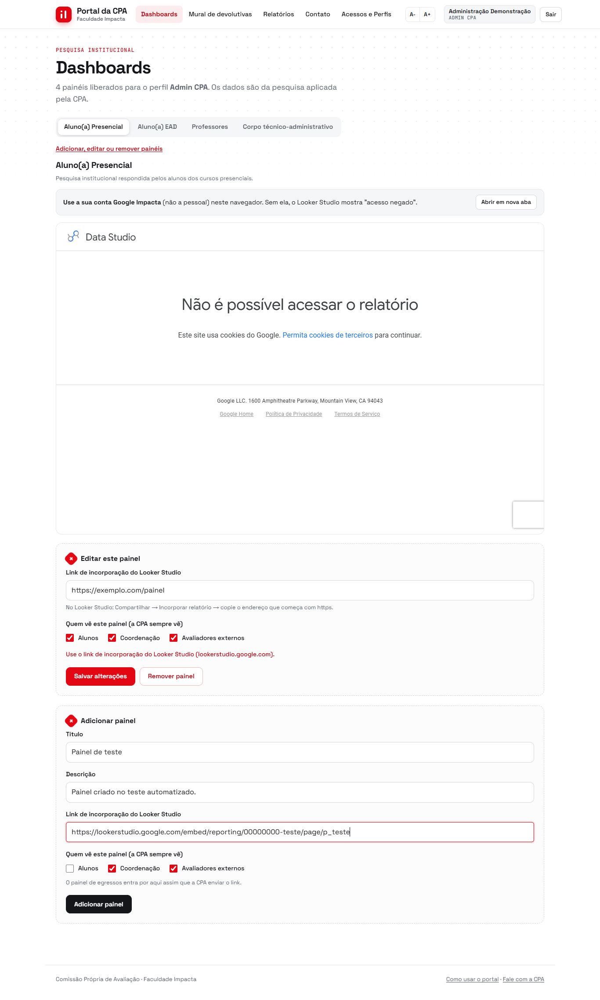

### 6.2 Mural
Abra **Publicar devolutiva**, preencha área, demanda, resposta, situação e data e clique **Publicar no mural**. Em cada cartão: **Marcar como resolvida / em andamento** e **Remover** (com confirmação).

| Publicar | Mural com os botões da CPA |
|---|---|
| 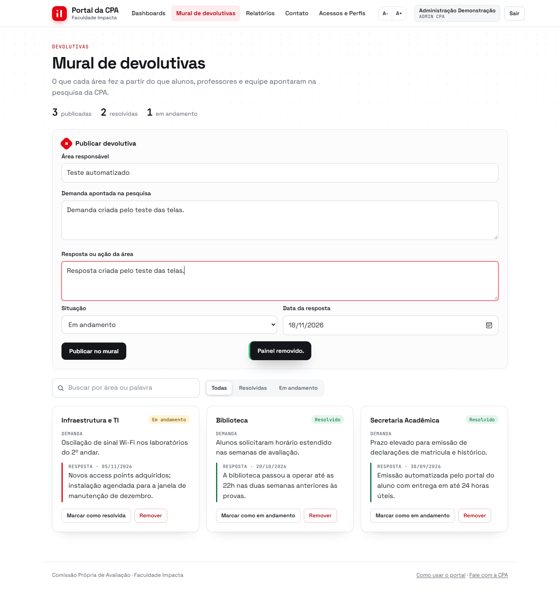 | 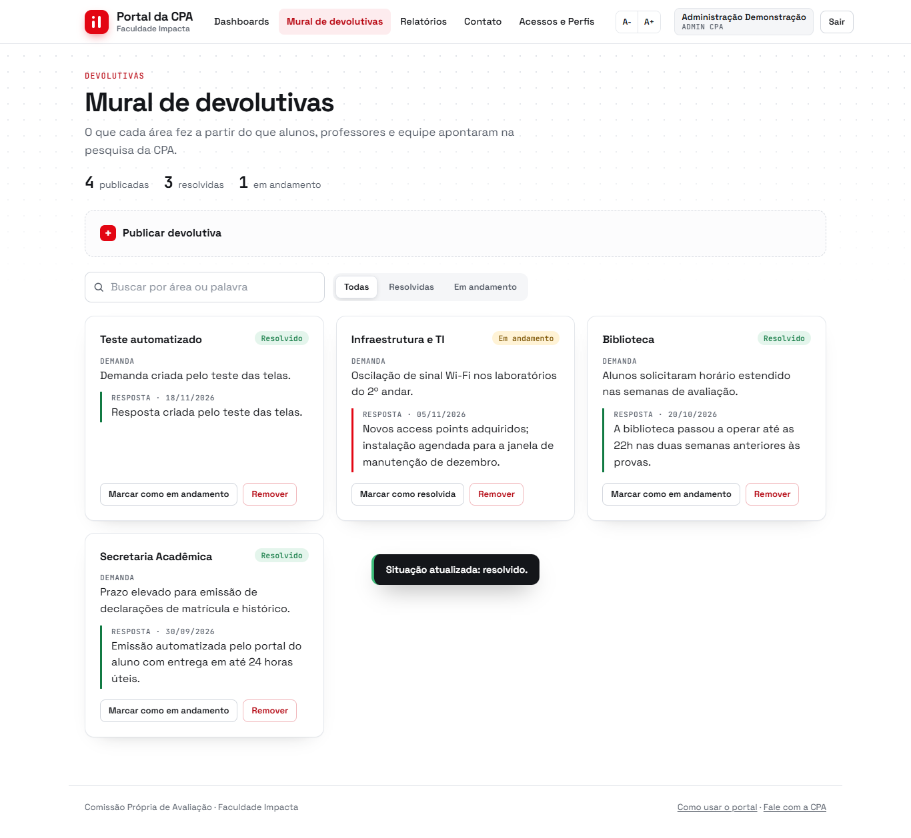 |

### 6.3 Relatórios
Abra **Enviar documento**, informe título, tipo (Relatório, Boletim ou Ata), data e escolha o PDF (até 50 MB). Clique **Enviar e publicar**. **Remover** apaga o documento e o arquivo.

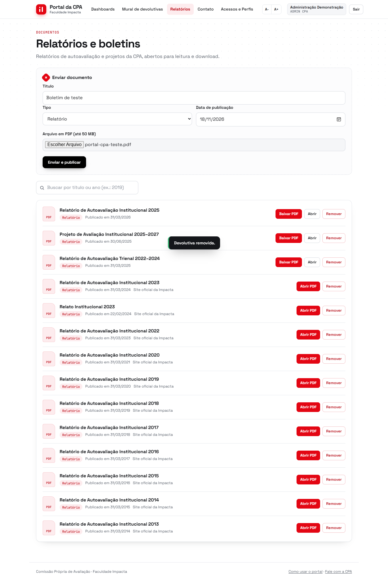

### 6.4 Contato
Em **Editar atendimento**, cadastre os links do Google Chat e do Meet (começando com `https://`), o horário e o e-mail da CPA. Clique **Salvar**.

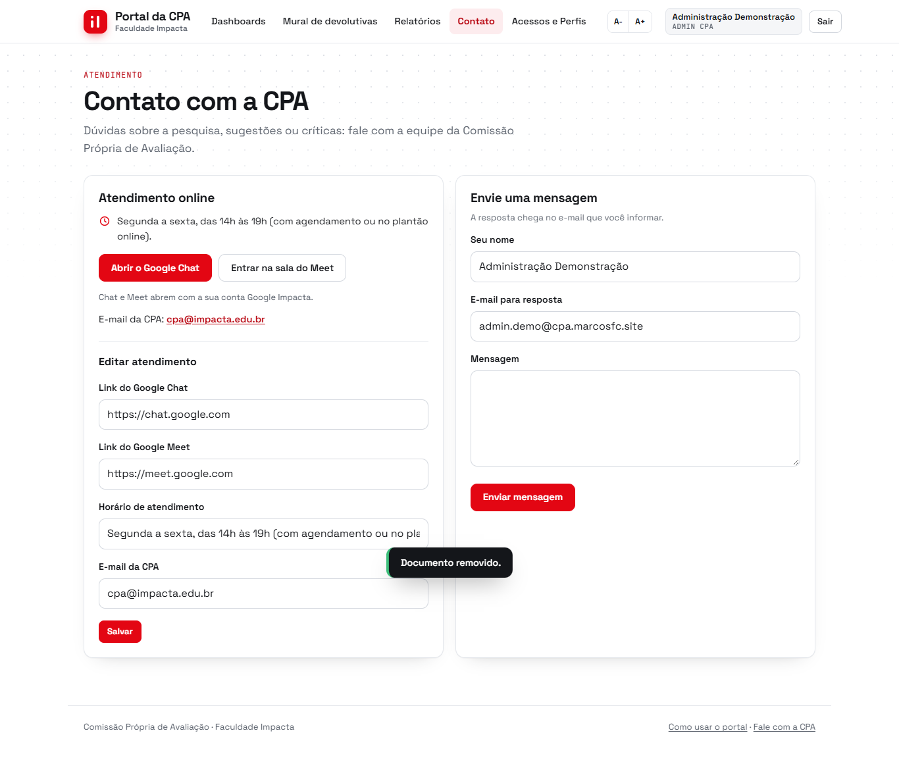

As mensagens do formulário chegam por e-mail (com "responder" já apontando para quem escreveu) e ficam em Acessos e Perfis → Mensagens.

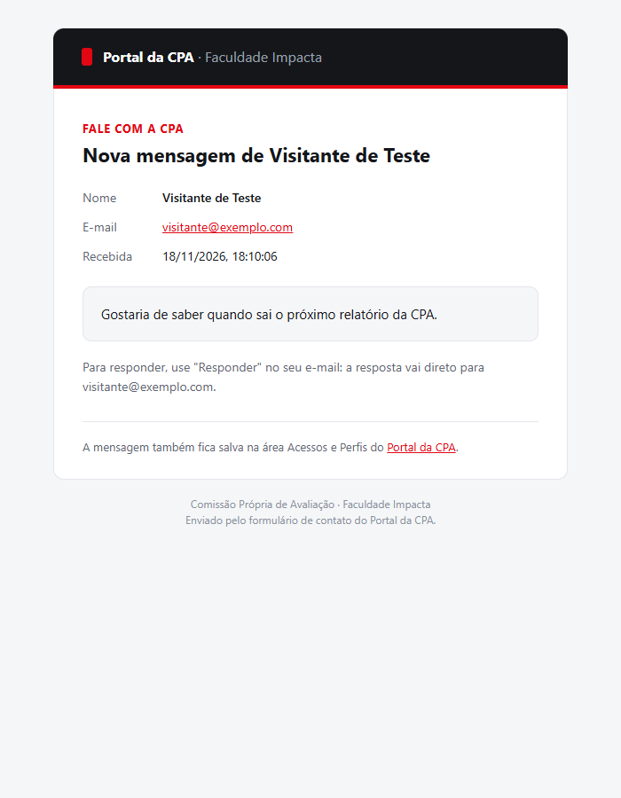

### 6.5 Acessos e Perfis
Menu **Acessos e Perfis** (só aparece para a CPA).

- **Coordenação e CPA**: cole os e-mails (um por linha), escolha o perfil e clique **Autorizar**. Marque **Enviar convite por e-mail** para a pessoa receber o aviso. **Revogar** tira o acesso (pede confirmação). Acessos marcados como **Protegido** (dono do portal e contas de demonstração) não podem ser alterados.
- **Avaliadores externos**: nome, e-mail e **Acesso até**; **Salvar e enviar convite**. **Reenviar convite** manda de novo (se a validade venceu, renova por 60 dias).
- **Quem vê o quê**: tabela com o que cada perfil acessa.
- **Histórico de acessos**: os últimos 100 acessos (quem, perfil, quando e como entrou).
- **Mensagens**: o que chegou pelo formulário de contato; **Responder** abre o seu e-mail; **Apagar** remove.

| Autorizar | Avaliadores |
|---|---|
| 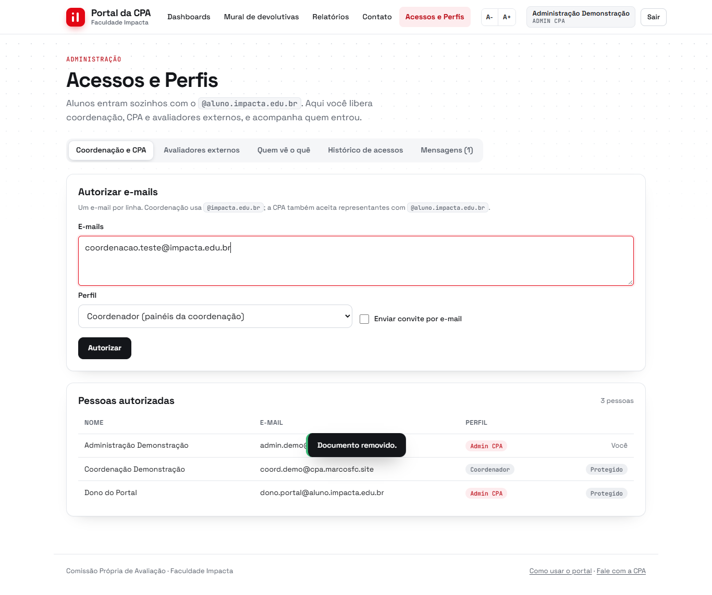 | 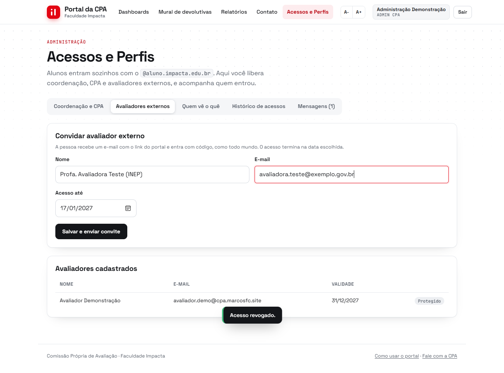 |

| Histórico | Mensagens |
|---|---|
| 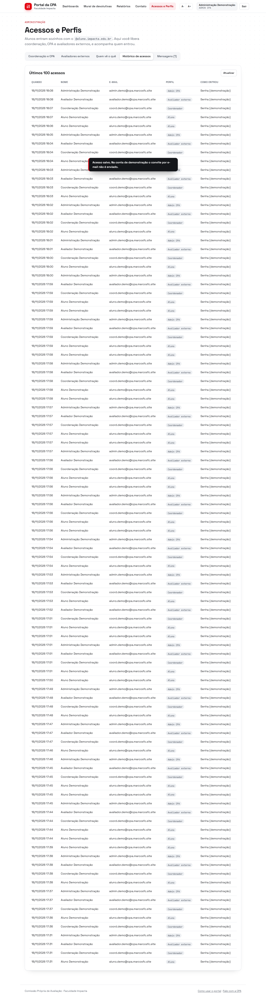 | 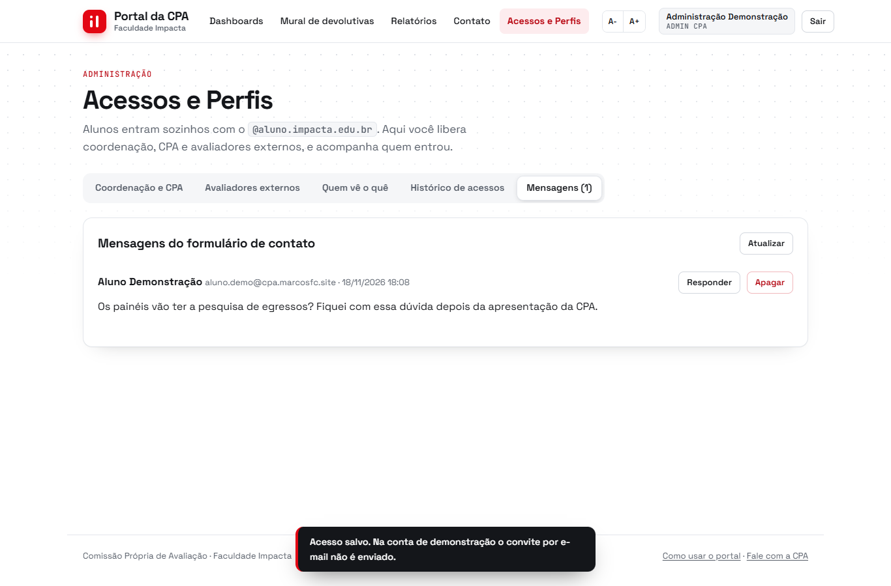 |

**Na conta de demonstração** (`admin.demo`): convites não são enviados por e-mail, não é possível criar outro administrador e o histórico e as mensagens mostram só as contas de demonstração.

## 7. Problemas comuns

| O que aparece | O que fazer |
|---|---|
| "Este e-mail não tem acesso ao portal" | Alunos usam o `@aluno.impacta.edu.br`. Coordenação e avaliadores precisam ser autorizados pela CPA. |
| "Este e-mail de aluno não está no formato esperado" | Digite o e-mail sem acentos e sem espaços, como foi fornecido pela faculdade. |
| "O seu acesso terminou em dd/mm/aaaa" | Peça a renovação à CPA. |
| "Código incorreto ou vencido" | Confira os números ou peça um novo código (vale 10 minutos e só uma vez). |
| "Você já pediu vários códigos" | Espere 10 minutos. |
| Painel mostra "acesso negado" ou "Não é possível acessar o relatório" | Entre com a conta Google da Impacta no navegador ou use **Abrir em nova aba**. |
| "Não foi possível carregar..." com o botão **Tentar de novo** | Falha de conexão. Confira a internet e clique **Tentar de novo**. |
| "Sua sessão expirou. Entre de novo." | Clique **Entrar** e faça o login de novo. |

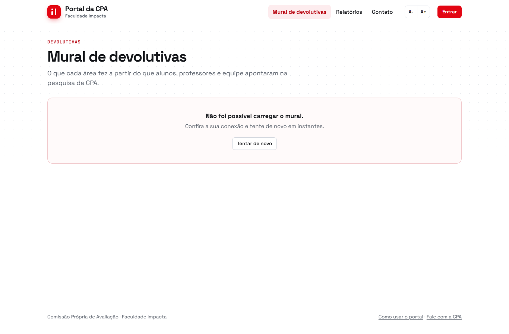
