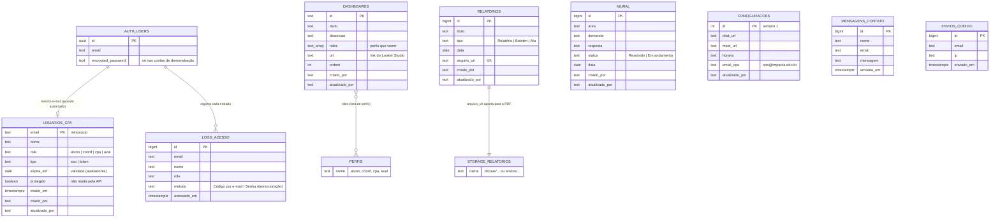

# Modelo de dados

O banco é um Postgres no Supabase. Os arquivos que criam tudo estão em [`supabase/`](../supabase):

- `schema.sql`: tabelas, funções, regras de segurança (RLS) e o bucket dos PDFs. Pode ser rodado mais de uma vez.
- `migracoes/002_demo.sql`: as mudanças da entrega final (contas de demonstração, acessos protegidos, gestão de painéis), para bancos que já tinham o `schema.sql` antigo.
- `migracoes/003_email_cpa.sql`: coluna `email_cpa` em `configuracoes` (e-mail institucional mostrado em Contato).
- `seed.sql`: dados iniciais (painéis, devolutivas de exemplo, links de atendimento, dono do portal e contas de demonstração).

As contas de login ficam na tabela `auth.users`, que é do próprio Supabase Auth. O portal liga a pessoa logada às suas permissões pelo **e-mail** que vem no token da sessão.

## Diagrama

`PERFIS` não é uma tabela: é a lista fixa de perfis usada na coluna `roles` de `dashboards` e na coluna `role` de `usuarios_cpa`. `STORAGE_RELATORIOS` é o bucket público `relatorios` do Supabase Storage.

## Tabelas

| Tabela | Para que serve | Observações |
|---|---|---|
| `usuarios_cpa` | Quem tem acesso além dos alunos: coordenação (`coord`), CPA (`cpa`), avaliadores externos (`aval`). | `expira_em` vazio = sem prazo. `protegido = true` para o dono do portal e as contas de demonstração. O perfil `aluno` aqui só é usado pela conta de demonstração. |
| `dashboards` | Painéis do Looker Studio exibidos em Dashboards. | `roles` = perfis que veem o painel. `url` precisa começar com `https://lookerstudio.google.com/` ou `https://datastudio.google.com/` (regra do banco). |
| `mural` | Devolutivas: demanda apontada na pesquisa e a resposta da área. | Leitura pública. |
| `relatorios` | Documentos publicados (relatórios, boletins, atas). | `arquivo_url` é o link público: um PDF do bucket `relatorios` (enviado pela CPA) ou o PDF oficial no site da Impacta (`account.impacta.edu.br`, relatórios anteriores). Um registro por arquivo. |
| `configuracoes` | Links do Google Chat e do Meet, horário de atendimento e e-mail da CPA. | Uma linha só (`id = 1`). `email_cpa` precisa ter formato de e-mail (regra do banco). |
| `logs_acesso` | Histórico de entradas no portal. | Cada pessoa só grava o próprio acesso. |
| `mensagens_contato` | Mensagens do formulário de contato. | Gravadas pelo servidor (`/api/contato`). |
| `envios_codigo` | Controle de quantos códigos cada e-mail e cada IP pediram. | Só o servidor acessa (sem políticas = ninguém de fora lê nem escreve). |

As colunas `criado_por` e `atualizado_por` são preenchidas pelo próprio banco (gatilho `registrar_autor`) com o e-mail de quem está logado. Elas servem para o script `scripts/restaurar-demo.mjs` desfazer apenas o que as contas de demonstração mexeram.

## Funções

| Função | O que devolve | Uso |
|---|---|---|
| `meu_perfil()` | O perfil de quem está logado: o `role` de `usuarios_cpa` (se a validade estiver em dia); senão `aluno` para e-mails `nome@aluno.impacta.edu.br`; senão `vis` (sem perfil). | Base de todas as regras de acesso. Roda no banco, então não dá para "trocar de perfil" pelo navegador. |
| `eh_cpa()` | `true` se `meu_perfil()` for `cpa`. | Atalho usado nas regras de escrita. |
| `meus_dados()` | `{ perfil, nome }` de quem está logado. | O navegador chama logo depois do login (coordenação e avaliadores não podem ler `usuarios_cpa`, então o nome vem por aqui). |
| `eh_demo()` | `true` se o e-mail da sessão for de uma conta de demonstração (`@cpa.marcosfc.site`). | Limita o que a administração de demonstração vê e faz. |
| `registrar_autor()` | (gatilho) | Preenche `criado_por` e `atualizado_por`. |

## Regras de segurança (RLS), em linguagem simples

Todas as tabelas têm RLS ligado: sem uma regra que permita, o acesso é negado.

| Tabela | Quem lê | Quem escreve |
|---|---|---|
| `dashboards` | quem tem o próprio perfil na lista `roles` do painel; a CPA lê todos. Visitante não lê nenhum. | só a CPA cria, altera e remove. |
| `mural` | todo mundo, inclusive sem login. | só a CPA. |
| `relatorios` | todo mundo. | só a CPA. |
| `configuracoes` | todo mundo. | só a CPA altera. |
| `usuarios_cpa` | só a CPA. | só a CPA, e: linhas protegidas não podem ser alteradas nem apagadas; ninguém cria linha protegida; a conta de demonstração não cria nem promove ninguém a `cpa`. |
| `logs_acesso` | só a CPA (a demonstração só vê acessos de contas de demonstração). | cada pessoa logada grava o próprio acesso, com o próprio e-mail e o próprio perfil. |
| `mensagens_contato` | só a CPA (a demonstração só vê mensagens enviadas por contas de demonstração). | gravadas pelo servidor; a CPA apaga. |
| `envios_codigo` | ninguém (só o servidor). | ninguém (só o servidor). |
| Storage `relatorios` | todo mundo baixa os PDFs. | só a CPA envia e apaga. O bucket só aceita `application/pdf` até 50 MB. |

As funções do servidor (`/api`) usam a chave de serviço, que passa por cima do RLS. Por isso elas repetem as regras importantes no código: `/api/convite` confere se quem chama é da CPA, recusa alterar acessos protegidos e não deixa a conta de demonstração criar administrador nem enviar e-mails.

## Como aplicar

Num projeto novo do Supabase, no **SQL Editor**: rode `schema.sql` e depois `seed.sql`. Num banco que já tinha a versão anterior: rode `migracoes/002_demo.sql`, `migracoes/003_email_cpa.sql` e depois `seed.sql`. Todos podem ser rodados de novo sem duplicar dados.
