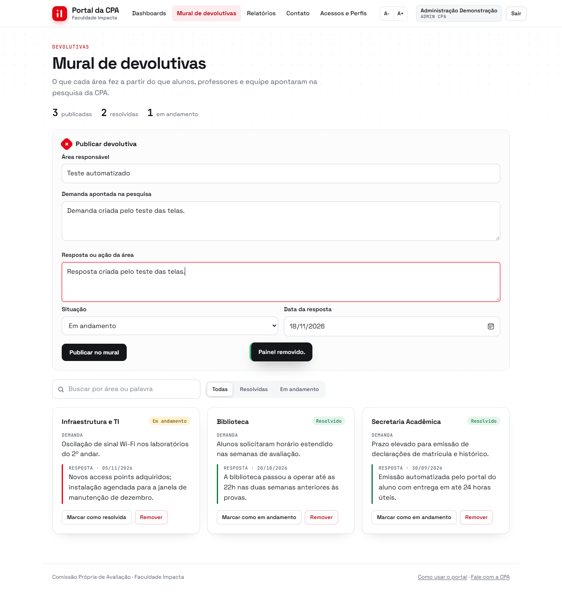
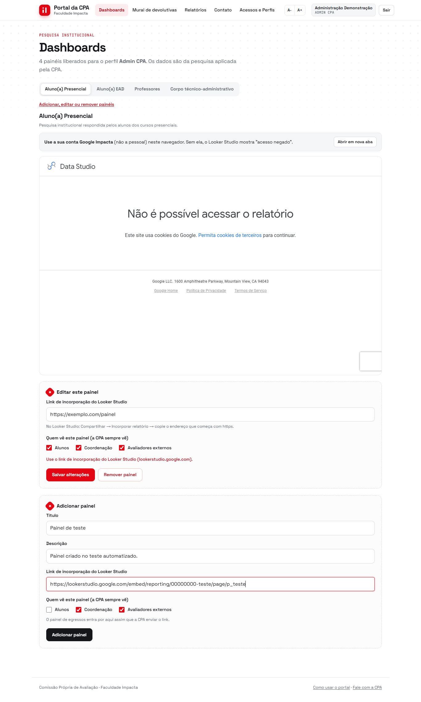

# Guia rápido — Administração da CPA

Portal da CPA: **https://cpa.marcosfc.site** · Manual completo: [manual do usuário, seção 6](../manual-do-usuario.md#6-administração-cpa)

Os quadros tracejados em cada tela são as ferramentas da CPA. Clique no título do quadro para abrir.

## Publicar uma devolutiva
**Mural** → **Publicar devolutiva** → área, demanda, resposta, situação e data → **Publicar no mural**. Em cada cartão: **Marcar como resolvida** e **Remover** (pede confirmação).

## Publicar um relatório ou boletim
**Relatórios** → **Enviar documento** → título, tipo, data e o PDF (até 50 MB) → **Enviar e publicar**. **Remover** apaga o documento e o arquivo.

## Painéis do Looker
**Dashboards** → **Adicionar, editar ou remover painéis** (atalho acima do painel).
- **Editar este painel:** link de incorporação e quem vê (Alunos, Coordenação, Avaliadores externos).
- **Adicionar painel:** título, descrição, link e quem vê. Link: no Looker, *Compartilhar → Incorporar relatório*, copie o endereço `https://lookerstudio.google.com/embed/...`.
- O painel de **Egressos** entra por aqui quando o link estiver pronto (marque Coordenação e Avaliadores externos).

## Contato
**Contato** → **Editar atendimento**: links do Google Chat e do Meet, horário e o e-mail da CPA.

## Liberar acessos
**Acessos e Perfis**
- **Coordenação e CPA:** cole os e-mails (um por linha), escolha o perfil, marque **Enviar convite por e-mail** se quiser → **Autorizar**. **Revogar** tira o acesso.
- **Avaliadores externos:** nome, e-mail e data **Acesso até** → **Salvar e enviar convite**.
- **Histórico de acessos** e **Mensagens** (formulário de contato; **Responder** abre o seu e-mail).

Acessos marcados **Protegido** não podem ser alterados pelo portal.

Roteiro de treinamento: [roteiro-treinamento-administracao.md](roteiro-treinamento-administracao.md) · Dúvidas: [FAQ](faq.md)
