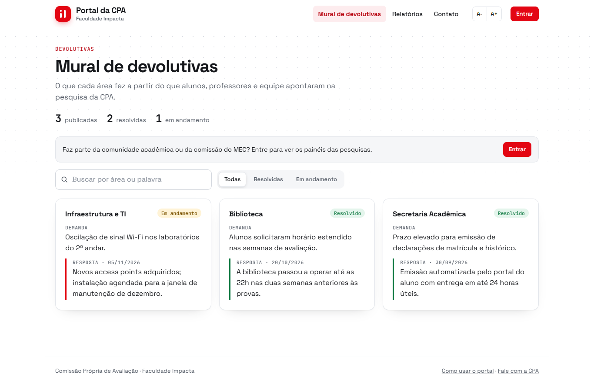
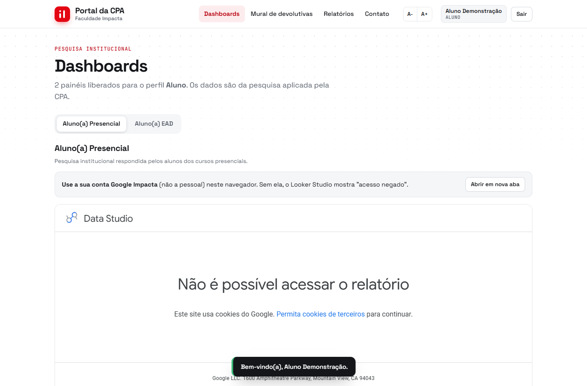

# Guia rápido — Aluno

Portal da CPA: **https://cpa.marcosfc.site**

## Ver as devolutivas e os relatórios (sem login)
1. Abra o portal. A primeira tela é o **Mural de devolutivas**: o que cada área fez a partir da pesquisa.
2. Digite um assunto em **Buscar por área ou palavra** (ex.: biblioteca) ou use **Resolvidas / Em andamento**.
3. Em **Relatórios**, busque por título ou ano e clique **Baixar PDF** ou **Abrir PDF**.

## Ver os painéis da pesquisa
1. Clique **Entrar**.
2. Digite o seu e-mail **@aluno.impacta.edu.br** e clique **Receber código**.
3. Abra o e-mail "… é o seu código de acesso ao Portal da CPA" e digite os 6 números.
4. Você vê os painéis **Aluno(a) Presencial** e **Aluno(a) EAD**. Troque pelas abas.
5. Se o painel disser "acesso negado", entre na sua **conta Google da Impacta** no navegador ou clique **Abrir em nova aba**.

## Falar com a CPA
**Contato** → Google Chat, Google Meet, o e-mail **cpa@impacta.edu.br** ou o formulário (a resposta chega no e-mail que você informar).

Dúvidas comuns: [FAQ](faq.md).
