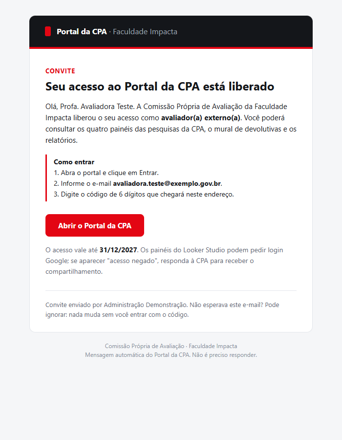
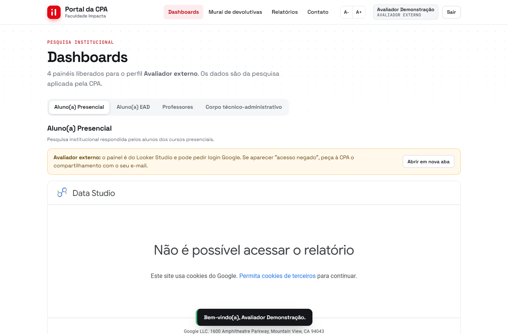

# Guia rápido — Avaliador externo

Portal da CPA da Faculdade Impacta: **https://cpa.marcosfc.site**

## Acesso
1. A CPA envia um convite para o seu e-mail com o link do portal e a data até quando o acesso vale.
2. No portal, clique **Entrar**, digite o mesmo e-mail e clique **Receber código**.
3. Digite os 6 números recebidos por e-mail.

## O que você vê
- **Dashboards:** todos os painéis da avaliação institucional (alunos presencial e EAD, professores, corpo técnico-administrativo; egressos quando a CPA cadastrar).
- **Relatórios:** os relatórios de autoavaliação de 2013 a 2025, o trienal 2022–2024, o Relato Institucional 2023 e o Projeto de Avaliação Institucional 2025–2027. Use a busca por ano.
- **Mural:** as respostas das áreas às demandas da pesquisa.

## Se o painel mostrar "acesso negado"
Os painéis são do Looker Studio (Google) e dependem de permissão no Google. Peça à CPA (**cpa@impacta.edu.br** ou pela página **Contato**) que compartilhe os relatórios do Looker com o seu e-mail. Os documentos em **Relatórios** abrem sem essa permissão.

## Validade
Depois da data informada no convite, o portal avisa que o acesso terminou. Peça a renovação à CPA.

Dúvidas comuns: [FAQ](faq.md).
