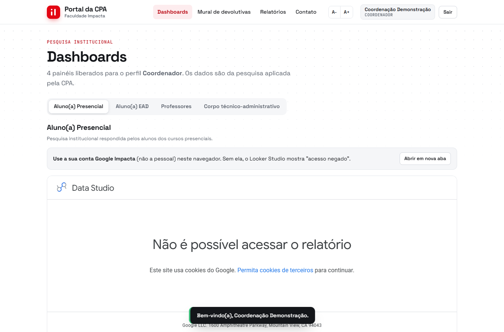

# Guia rápido — Coordenação

Portal da CPA: **https://cpa.marcosfc.site**

## Antes do primeiro acesso
A CPA precisa autorizar o seu e-mail **@impacta.edu.br**. Você pode receber um convite por e-mail com o link do portal.

## Entrar
1. Clique **Entrar**, digite o seu e-mail e clique **Receber código**.
2. Digite os 6 números que chegaram por e-mail (o código vale 10 minutos e só uma vez).
3. Se não chegar em 1 minuto, confira o spam; depois de 60 segundos dá para pedir outro código.

## Painéis da coordenação
Você vê quatro painéis: **Aluno(a) Presencial**, **Aluno(a) EAD**, **Professores** (avaliação docente) e **Corpo técnico-administrativo**. O painel de **Egressos** aparece aqui quando a CPA cadastrá-lo.

1. Clique na aba do painel.
2. Use a sua **conta Google da Impacta** no navegador; sem ela, o Looker mostra "acesso negado".
3. **Abrir em nova aba** mostra o painel em tela cheia.

## Acompanhar as devolutivas
No **Mural**, busque pelo nome do seu curso ou da sua área e filtre por **Em andamento** para ver o que ainda falta resolver.

Dúvidas comuns: [FAQ](faq.md).
